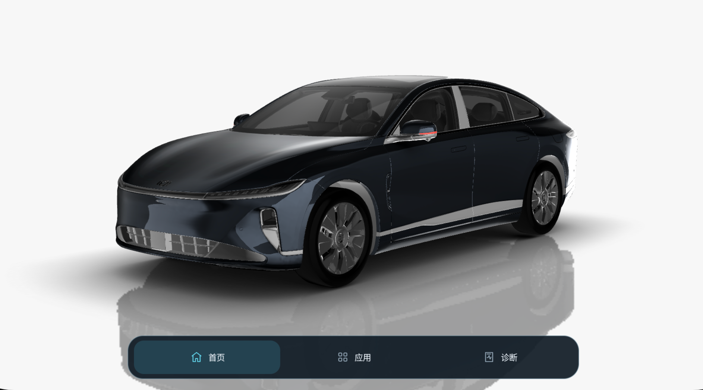
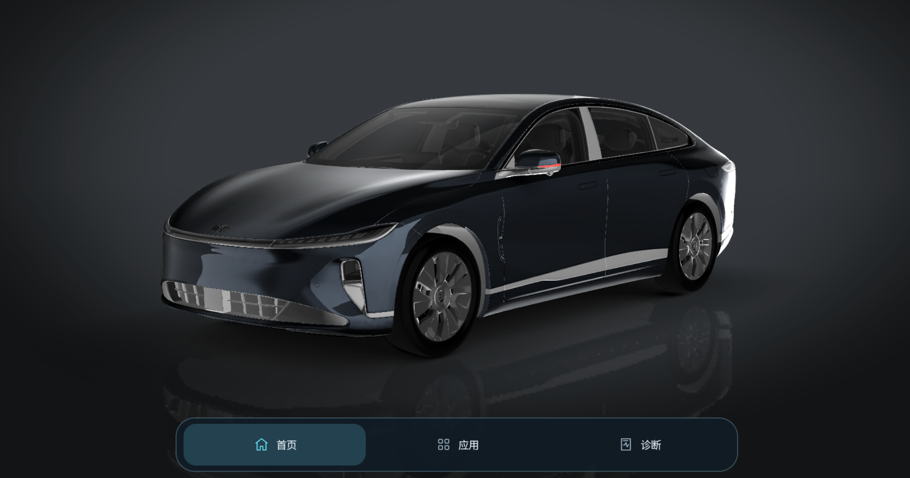

# 启航桌面

一个带 3D 车模的安卓桌面，适合横屏大屏使用，支持 Android 11 及以上版本。

目前车控只是演示，还不能控制真实车辆。

## 界面

日间



夜间



## 怎么用

- 拖动车辆转动视角，双指缩放。
- 长按“首页”打开车控面板，可以开关门窗、尾门和灯光，也能换车色和视角。
- 点击“首页”或按返回键收起面板。
- 停止调整视角 12 秒后，镜头会自动回到默认位置。
- 点击“应用”，查看并打开已安装的应用。
- 日间和夜间外观跟随系统设置。

## 自己编译

用 Android Studio 打开项目，使用 Java 17，按提示安装所需工具。等待下载完成后，在项目目录运行：

```sh
./gradlew :app:assembleDebug
```

安装包在 `app/build/outputs/apk/debug/app-debug.apk`，可以传到安卓设备安装，或拖进模拟器。

## 关于

车模来自原车机资源。

Godot 的相关许可见 [许可文件](scripts/Godot3-IBL-LICENSE.txt)。
